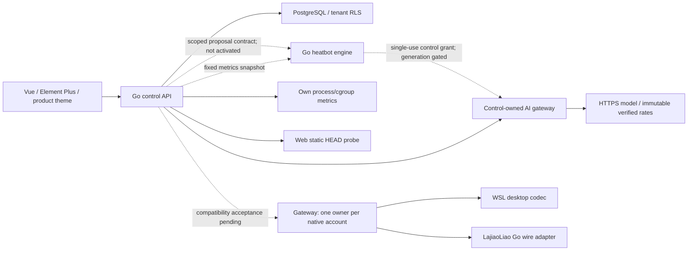

# Architecture Contract

The owner's 2026-11-10 controlled onboarding decision adds one temporary,
actor-owned demo scope for authentic pool-account proofs through the existing
customer wizard. Its distinct proof origin, immutable scope snapshots, shared
attempt limits and lifecycle fences are documented in
[scoped controlled onboarding](architecture/decisions/2026-11-10-controlled-onboarding.md).
Ordinary customer proof, native-debug grants and production source admission
remain separate.

The owner's subsequent 2026-11-10 correction permits slider-free onboarding
only after control verifies the actor's live, own-demo, platform/account/group
test scope. The HTTP layer defers challenge creation and sealed contact
approval/rejection verification to their handlers so control can resolve this
scope. Ordinary requests retain one-use CAPTCHA; final native fences and
explicit human confirmation remain. No account boolean or browser flag grants
the exception, and expired/closed scopes cannot fall back into an executable
ordinary request.

Source-backed views, incremental analysis and CI maintenance:
[`architecture/README.md`](architecture/README.md). Those generated inventories
do not overwrite the human decisions in this contract.

Decision dates: 2026-10-25 (Go runtime), 2026-10-27 (approved cross-platform
pools and user center), 2026-10-29 (approved tenant membership, commercial
periods and shared credit gateway). This supersedes the former Python-runtime proposal
and former workspace-based 100-group limits.
The owner's 2026-10-31 product decision keeps the Web management assistant,
retires the independent platform chat entry and classifies learning/memory/people
as optional first-party extensions. Implementation and target boundaries are
separated in [the managed-service decision](architecture/decisions/2026-10-31-managed-service-and-extensions.md).
The owner's 2026-11-02 plan adds the dual-platform, single-group assistant and
separate human-confirmed business action admission; see
[the assistant decision](architecture/decisions/2026-11-02-dual-platform-assistant.md).
The owner's 2026-11-03 monitoring decision retires Simon. API and heatbot
collect only their own process/cgroup metrics; database observation is confined
to the current business database and Web observation is static reachability.
The owner's 2026-11-05 customer onboarding and group-business plan adds
authenticated message proofs, owner-managed member grants, operator capability
ceilings and independent durable automatic rules; see
[the customer and business decision](architecture/decisions/2026-11-05-customer-group-business.md).
The owner's 2026-11-05 workspace/demo plan separates operator governance from
human business use; see [workspace and entitlement wiring](operator-demo-workspaces.md).
Control derives a live human `operator_demo` entitlement and platform billing
without changing the resource tenant or background consumers.
The owner's 2026-11-06 correction adds an explicit operator test claim for
already bound groups without a customer login or subscription; see
[operator test-claim evidence](architecture/decisions/2026-11-06-operator-test-claim.md).
The same day's approved space and friend-onboarding plan adds genuine
operator-owned resources and an independent single-application proof path; see
[operator spaces and friend onboarding](architecture/decisions/2026-11-06-demo-workspace-friend-onboarding.md).
The owner's latest 2026-11-08 correction replaces customer robot-initiated
friend requests with an exact-name/server-time selection of one incoming
application, human approval and independent authenticated private/group proofs.
Name and time select a contact but never establish identity or ownership.
Native outbound lookup/application remains controlled-test-only; historical
operations retain reconciliation. See
[incoming contact onboarding](architecture/decisions/2026-11-08-incoming-contact-onboarding.md).

The owner's 2026-11-10 correction makes stale incoming requests default to
rejection during an explicit onboarding check. Control first prefers a unique
current-window request; otherwise it may seal one unique same-name pending
request at least ten minutes older than the server challenge start. A separate
captcha-protected confirmation (or an explicit confirmation dialog inside a
live controlled onboarding scope) submits only that sealed rejection once. Read,
refresh, expiry and background consumers do not reject. Confirmed rejection ends
the old challenge and requests a new application; unknown results reconcile the
original record. This cleanup policy establishes no website or group identity,
including when the old sender is an owner-controlled pool account. Normal
approval and identity proofs retain their non-pool sender checks.

The owner's 2026-11-09 decision adds dual-platform `friend_delete` as a manual
account capability on the existing superadmin controlled-test surface. A separate
persisted `native_debug` window fixes one account, one current non-self friend,
one attempt and a bounded deadline; an active isolated group binding, current
owner/admin role, receiver, epoch and final submission fences remain required.
It reuses the sealed settings ledger and account read queue, with no new service
or assistant/heatbot/business dependency. Unknown submissions remain read-only.
Temporary deletion of the explicitly authorized test relationship is a separate
human action; customer onboarding cancellation or expiry never deletes friends
or recreates a relationship. Both platforms' real deletion acceptance is pending.
See [account social operations](native-social.md) and [controlled tools](controlled-tools.md).

The same day's owner-directed incoming application acceptance adds a separately
scoped `friend_approve` test window. It fixes one native application identifier,
one applicant, account and isolated group, `native_debug`, one attempt and at most
300 seconds. A normal group social read still does not fetch applications; only
the explicit approval read/submit does. Chili's applicant-only native response
route additionally requires exactly one pending incoming application from that
applicant. The existing sealed settings ledger, final fences and read-only
unknown reconciliation are reused. Normal onboarding retains its own proof and
approval records; this test neither proves customer ownership nor enables
business, assistant or heatbot access. Forward migration 066 adds only the
persisted application scope and singleton constraint.

## Ownership

| Boundary | Owner | Prohibited |
| --- | --- | --- |
| Browser | `web/src/wsl` | Native credentials, native protocol, implicit activation on view switching |
| Identity / SaaS / configuration | `internal/httpapi`, `internal/control` | Trusting browser tenant IDs; exposing shared credentials |
| Website human verification | `internal/httpapi` scoped admission + `internal/webcaptcha` bounded puzzle state | Native credentials, database persistence, granting business permissions or work in receive/ACK |
| Feature definitions / native capability contracts / validation | `internal/features` | Transport, native execution, database access or fictional controls |
| Native protocol / durable receive | `internal/nativeauth`, `internal/nativewire`, `internal/lajiaoliao`, `internal/gateway` | AI/model/member-list work in the receive/commit/ACK path; per-account bridge processes |
| Platform identity | `internal/platform`, PostgreSQL constraints | Using UI workspace as protocol/pool identity; relabeling existing accounts |
| Read-only native conversations | `internal/nativewire` codec, `internal/gateway` bounded decoder, `internal/httpapi` scoped projections | Sending, implicit group authorization, tenant access to shared private messages, plaintext persistence |
| Chat computation | `internal/heatbot`, `cmd/heatbot` | Native sends, moderation, payments, host commands, database bypass |
| Assistant core / Eino adapter | `internal/assistant` / `internal/assistantadapter` | Trusted identity, database/native/finance access, model apply tools; Eino outside adapter |
| AI model admission / credit ledger | `internal/control`, pure `internal/aigateway` arithmetic and scheduler | Client-supplied trusted scope, direct heatbot vendor keys, duplicate legacy charging |
| Shared configuration | Go API + sealed PostgreSQL records | Global mutable persona rotation; plaintext provider secrets |
| Tenant business data | Restricted PostgreSQL role + forced RLS | Global search or scope-less retrieval |
| Monitoring | `internal/monitor` interfaces/cache + executable-injected `internal/metricsproc` | Host mounts/PID, Docker socket, other processes, environment/command line, arbitrary proxy |

The operator provides both the account pool and robot business functionality;
customers authorize groups and configure the supplied service. The Web assistant
is a conversational configuration surface beside forms, not a group-message
consumer. Operator governance uses safe assistant audit metadata and admission
controls rather than a separate platform AI configuration conversation.
Legacy platform-assistant storage and endpoints remain for compatibility and
financial reconciliation; hiding its UI alone is not a backend retirement.

Optional extensions must execute outside ingress commit/ACK and protocol
projection. Disabled modules must not enqueue tasks, retrieve context, build
indexes or call models. This is the accepted implementation requirement, not a
claim that an extension scheduler already exists or that shared resources incur
zero measurable contention. Existing account learning/memory defaults and
`heatbot.ContextSnapshot` are not a running group-scoped extension pipeline.

## Admission And Runtime

Two console views are governance and user center. Platform filters remain WSL
and LajiaoLiao; the governance-only chat account pool retains its legacy
`maibot` view. A view never owns or starts a connection. Superadmin human use in
user center bypasses commercial limits and customer automatic runtime, while
source-specific production gates, binding ownership, native roles and final
submission fences remain mandatory. Missing customer ownership anchors can be
replaced only for that superadmin's human demo by an independently persisted,
ten-minute native-authority verification; it never becomes customer evidence.
Background work for customer resources uses customer entitlement and its wallet.
An explicitly enabled operator-owned demo space uses a service execution context
and platform workspace billing; it never inherits a human website session.
Independent page plans reuse native persistence
without creating assistant sessions or controlled-test grants.
Management and chat each admit 10 native accounts, shared by both platforms;
each account admits 30 active bindings. At most 300 native management groups
can be authorized; chat can cover those same 300 groups, not 300 additional
ones. Native identity and native group uniqueness include platform. Existing
WSL sessions and credentials retain their identities and sealed formats.
Chat-group authorization derives from the approved tenant/group binding and
the package's platform/module/AI quota.
AI intent, including requests waiting for an account, reserves chat quota.
An account's pending or active binding reserves its panel even while offline.

These are admission limits, not measured capacity. The former 30-AI-group target
is superseded. The 8-core/32-GB load and 24-hour tests must be repeated against
the Go replacement before production acceptance.

Engine limits: four calls globally, one active per tenant/group, one replaceable
pending candidate per platform/tenant/group, at most 300 admitted group states.
Pending replacement never deletes persisted source messages. Account, binding,
persona and expiry snapshots accompany every proposal; control must revalidate
them before sending. The engine has no native sender.

## Runtime And Release

Robot removal physically clears account-owned configuration and credentials in
one transaction, fences in-flight authentication, and disables affected group
services. Detached tenant ownership and immutable financial/activity history
remain. Unresolved native submissions block removal. Cleanup and backup recovery
boundaries are specified in `docs/account-removal.md`.

Only `compose.yaml` is a supported deployment. API, frontend, Go heatbot,
and PostgreSQL run in containers. No monitoring sidecar or collector process
is deployed. Python files under `ai/` are historical
contract test oracles only; they are not built into production images.
No upstream MaiBot UI or Python process is deployed.

Desktop authentication and reception retain the explicit `2.8.3` contract.
An optional Android `3.7.4` business companion supports manual authentication
and fixed controlled-test friend-search/application routes only. It has a
separate sealed profile and session bound to the existing management account,
native identity, account epoch and mobile deployment version. It never creates
an IM token, receiver or second connection owner. Desktop authentication cannot
restore mobile sessions, and the companion cannot restore desktop credentials.
Implicit legacy defaults and unverified mobile versions remain rejected.
The two profiles share the existing durable request-number high-water mark.
Companion replacement or revocation does not modify desktop account credentials
or reception; unresolved outgoing applications block replacement. Both mobile
versions are checked again under the final control transaction's row locks.
The desktop business client and Web IM transport remain separate contracts;
untested phone coexistence and real mobile authorization remain acceptance items.
Desktop profiles bind the OS-specific client identity (`macos=10`,
`windows=11`) to saved sessions. An explicit superadmin configuration check reads
one fixed anonymous settings route; it cannot proxy arbitrary routes, authenticate
an account, activate reception, or raise a readiness gate.

`tools/check_architecture.py` checks Go dependency boundaries and Compose
security invariants. `tools/check_repository.py` checks accidentally included
secret/runtime artifacts, upstream locks and immutable migration hashes.
CI runs these checks, a pinned Gitleaks scan, container unit/integration and frontend build checks.
Release publishes API and web OCI images from a tested Git revision. Deployment
uses explicit image tags/digests and a maintenance window, not in-app self-update.

## Current Acceptance

The dual-platform management assistant is an optional, default-off control-plane
capability. `internal/assistant` owns bounded model orchestration and a Runtime
port; it never owns trusted identity, database access, native actions, finance
or heatbot. `internal/control` owns live authorization, safe projections, atomic
budget reservations, sealed history and immutable human-approved plans.
Legacy full-config, field-config and assistant approval share validation and
the version/epoch/queue-invalidation/audit commit core. The model has no apply
tool. Assistant grants and group action grants never inherit legacy roles.
Context resolves the bound management account server-side and paginates only the
website actor's authorized groups in the chosen platform. A model turn requires
one selected group. Immutable action proposals have a ten-minute deadline and
separate self-approval endpoints. Control uses its private business admission to
share durable native operations and final fences; it never borrows test windows
or native_debug. Every platform's production gate remains closed until accepted;
read/controlled evidence does not admit a production write.
`docs/management-assistant.md` defines scopes, retention, endpoints, limits,
recovery and rollout gates. The approved Eino v0.9.22 adapter implements the
existing Runtime port with explicit three-model/six-tool/90-second limits and
sequential tools. Core assistant remains free of third-party dependencies.
The shared control gateway is the production model entry for both consumers;
heatbot has one fixed private HTTP destination and a single-use trusted grant.
Global four/tenant two calls, bounded fair waiting, period-wallet reservations,
versioned rates and frozen unknown costs are independent of native execution.
The old assistant token ledger is read-only historical data, not a second charge.
`docs/commercial-billing.md` defines precise accounting and rollback boundaries.
Assistant development does not raise native/AI readiness or establish capacity.

The superadmin controlled acceptance interface exposes fixed JSON Tools through
the existing HTTP API, not through either AI runtime. A human-created isolated
test window bounds account, group, target, action, deadline and attempt count.
`internal/control` owns atomic reservations, sealed operations, final fences and
read-only reconciliation. Gateway adapters own only fixed desktop contracts
and current native evidence. No new transport owner or service is introduced.
`docs/controlled-tools.md` records implemented actions and remaining gates.

Receive-only transport, session-bound IM token renewal and durable raw ingress
are implemented in `internal/gateway`; see `docs/native-receiver.md`.
Read-only business group snapshots and authenticated text projections are
implemented; full media decoding, member-role mapping, native acceptance
and full MaiBot feature parity remain incomplete.
The conversation projection runs after durable raw ingress, outside the ACK
path. A shared, bounded Go worker pool authenticates application envelopes and
stores sealed, seven-day projections. Projections are read-only and account /
workspace scoped, initially superadmin-only. An observed native group is not
a SaaS-authorized group; unverified transport mappings cannot grant permissions.
`docs/native-conversations.md` defines format support, leases, directory limits,
pagination, retention and remaining acceptance boundaries.
Durable ingress sends a coalesced decoder wake signal; sealed projection
completion feeds a bounded process-local notification bus. Account-scoped SSE
delivers IDs and safe status only, reusing authorized query services for
snapshots and message bodies. Database reconciliation remains the source of
recovery. Notification loss or slow UI consumers cannot delay ACK or grant
native action permission; no full desktop process or extra service is added.
Neither readiness gate may be enabled by a configuration-only save or health
check. `docs/maibot-migration.md` is the capability-by-capability status source.
The cross-platform implementation status and rollout blockers are recorded in
`docs/multi-platform.md`. LajiaoLiao uses upstream push hints plus bounded
sequence recovery through one WebSocket owner per account. Sealed raw messages
and cursors commit atomically before notifying the shared decoder pool.
There is no invented network ACK: its health field is
`ack_mode=sequence_commit_only`. First attachment starts at verified heads;
gaps/regression stop the stream instead of skipping watermarks. Protocol
send/mute primitives are not yet production control actions. Packages
default to WSL only and existing quotas are not automatically raised.
Management feature fields and their individual permissions are defined in
`internal/features`; configuration and implementation status are documented in
`docs/feature-center.md`. Saving a feature switch never activates native execution.
The feature catalog declares native dependencies against the reviewed capability
registry. Unknown or unaccepted capabilities are catalog blockers. This metadata
does not authorize execution or replace control's final submission checks.

The selected-account dashboard exposes scoped database aggregates and, for
superadmins, fresh receive-only runtime observations. Model telemetry remains
unavailable. Measurement definitions, tenant
boundaries and unavailable live signals are specified in `docs/account-dashboard.md`.
