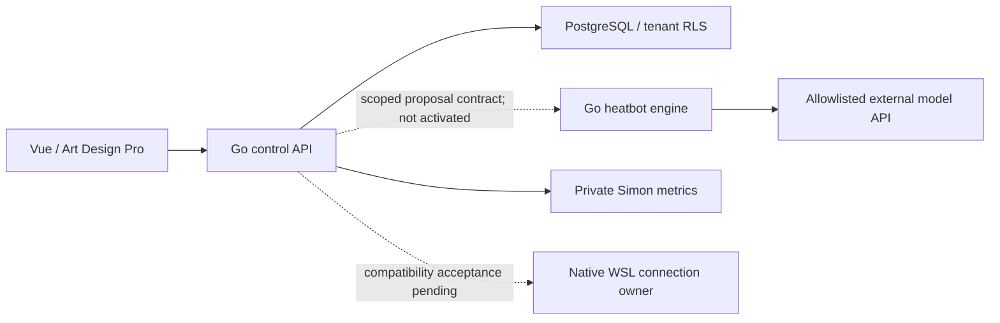

# Architecture Contract

Decision date: 2026-10-25. This supersedes the former Python-runtime proposal.

## Ownership

| Boundary | Owner | Prohibited |
| --- | --- | --- |
| Browser | `web/src/wsl` | Native credentials, native protocol, implicit activation on view switching |
| Identity / SaaS / configuration | `internal/httpapi`, `internal/control` | Trusting browser tenant IDs; exposing shared credentials |
| Native protocol / durable receive | `internal/nativeauth`, `internal/nativewire`, `internal/gateway` | AI/model/member-list work in the ACK path |
| Chat computation | `internal/heatbot`, `cmd/heatbot` | Native sends, moderation, payments, host commands, database bypass |
| Shared configuration | Go API + sealed PostgreSQL records | Global mutable persona rotation; plaintext provider secrets |
| Tenant business data | Restricted PostgreSQL role + forced RLS | Global search or scope-less retrieval |
| Monitoring | `internal/monitor` + private Simon | Host filesystem, Docker socket, process environment, arbitrary proxy |

## Admission And Runtime

Both workspaces independently admit 10 native account panels and 100 groups.
Native identity remains globally unique. Chat-group authorization derives from
the management workspace's approved tenant/group binding and package AI quota;
100 + 100 is not permission to create duplicate ownership of a native group.
AI intent, including requests waiting for an account, reserves chat quota.
An account's pending or active binding reserves its panel even while offline.

These are admission limits, not measured capacity. The former 30-AI-group target
is superseded. The 8-core/32-GB load and 24-hour tests must be repeated against
the Go replacement before production acceptance.

Engine limits: four calls globally, one active per tenant/group, one replaceable
pending candidate per tenant/group, at most 100 admitted group states.
Pending replacement never deletes persisted source messages. Account, binding,
persona and expiry snapshots accompany every proposal; control must revalidate
them before sending. The engine has no native sender.

## Runtime And Release

Only `compose.yaml` is a supported deployment. API, frontend, Go heatbot,
PostgreSQL and Simon run in containers. Python files under `ai/` are historical
contract test oracles only; they are not built into production images.
No upstream MaiBot UI or Python process is deployed.

`tools/check_architecture.py` checks Go dependency boundaries and Compose
security invariants. `tools/check_repository.py` checks accidentally included
secret/runtime artifacts, upstream locks and immutable migration hashes.
CI runs these checks, a pinned Gitleaks scan, container unit/integration and frontend build checks.
Release publishes API and web OCI images from a tested Git revision. Deployment
uses explicit image tags/digests and a maintenance window, not in-app self-update.

## Current Acceptance

Native transport/receiver/renewal and full MaiBot feature parity are incomplete.
Neither readiness gate may be enabled by a configuration-only save or health
check. `docs/maibot-migration.md` is the capability-by-capability status source.
