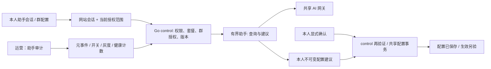

# 控制台分类、指标与助手分权

设计与实施日期：2026-10-30，Asia/Shanghai。以下“已实现”指当前候选代码；
实际检查和本地交付结果以 `test-report.md` 为准。服务开关、付费模型调用、
租户灰度和原生执行不能由页面布局变更自动开放。

## 导航与页面

保留用户中心、旺商聊、辣椒聊、热群四个视图。平台、账号用途、租户和账号身份
不由导航重命名；切换视图不启动连接、重放提交或变更配置。
二级标题只组织当前用户可访问的入口，空分类不显示，移动端与桌面共用同一权限结果。

| 二级标题 | 入口 | 对应工作 |
| --- | --- | --- |
| 工作空间 | 工作台、群组、消息中心 | 当前账号与授权群；消息中心继续仅超管 |
| 群管与服务 | 功能管理、群管助手、群授权申请 | 日常配置、建议与授权申请 |
| 聊天服务 | 人设、聊天配置、模型 | 仅热群视图、仅超管，未适配能力继续关闭 |
| 可选扩展 | 扩展中心 | 学习、记忆、人物、媒体与工具目录；未接入的运行开关禁用 |
| 记录与分析 | 操作、审计、引擎统计与日志 | 查询既有操作与运行证据 |
| 组织与订阅 | 成员权限、套餐积分、用户、SaaS 套餐 | 租户成员与平台管理分别按权限出现 |
| 平台运维 | 助手审计、AI 网关、受控测试、系统监控等 | 仅超管；不混入普通群配置 |
| 个人服务 | 用户中心、套餐积分、成员权限 | 用户中心中的个人及租户入口 |

财务台账、活动抽奖归入“功能管理 → 业务模块”，不再作为其平级标签；
目录默认面向业务配置，原生能力保留独立标签。业务子页提供返回入口和群筛选，
沿用所选群与账号范围。只有台账/活动读取权限的成员使用精简目录，
不额外请求群配置。其他精简候选、保留理由和实施顺序见
[`architecture/decisions/2026-10-31-business-module-consolidation.md`](architecture/decisions/2026-10-31-business-module-consolidation.md)。

已实现二级标题、权限过滤、隐藏空分类和当前页标识；修复原导航只记录 `admin`
元数据却未统一过滤的问题。深链接仍经过页面准入，接口继续独立校验。
补齐 hashchange 导航同步；已有授权群时进入功能管理立即加载当前平台目录，
不依赖下一次刷新或切换群。目录加载、渲染和跨平台隔离分别通过合成断言检查。

### 产品主题（2026-10-31）

按所有者要求，产品视觉改用本地 Voltline Analytics 模板的运营后台适配：
浅色分组导航、墨色选中项与细青柠标记，白色工作区和细分隔线形成层级。
主要操作使用墨色，青柠仅用于小范围标记；表格和无框分区保持紧凑，
图表及指标用蓝、绿、黄、红区分状态，不把整个界面染成同一种颜色。
平台网站登录为独立单列账号表单及两平台标识；原生账号登录仍是独立受控流程。
产品入口不再加载框架演示的全局 SCSS 和持久化暗色设置；
Vue、Element Plus、Element Plus X 及现有独立图表继续使用，未引入新依赖。
模板令牌与产品适配分开，使用本机字体及既有平台图片，保留模板许可和来源，
见 `web/src/wsl/theme/README.md`。

关闭的移动导航退出可访问性树和焦点顺序，展开按钮提供状态、支持 Esc 收起。
平台登录保留原认证 API，增加空输入与进行中重复提交拦截；
错误可读、密码可显示、用户名和密码仍使用各自的浏览器自动填充用途。
侧边栏同步提示来自当前刷新/错误/更新时间，不以固定“已连接”代替观测。
全局原生/AI未验收提示收进顶栏弹层，未测容量目标默认折叠；
工作台四项数字使用分栏带，手机图表完整显示四标签和状态图例。
网关配置按运行预算、模型连接、计价核验分组，钱包状态独立展示。
助手使用群按钮、原生昵称、明确的Web助手空态及底部输入区；
十轮保留、唯一空白会话和首问标题行为不因外观变化而调整。
主题不改变菜单权限、群范围、readiness、配置生效或模型预算。

## 指标口径

| 展示 | 数据与范围 | 无数据和异常 |
| --- | --- | --- |
| 工作台顶部数字 | 当前工作台 `/overview` 返回值 | 未返回显示未提供或破折号，不推导成功率 |
| 群服务柱图 | 本次返回的有效授权群、保存开启群管、热群已启用、热群待启用 | 图中类别可重叠，不相加成总量；配置不等于运行验收，不表示Web助手开关 |
| 操作环图 | 当前可见返回列表按状态分类 | 有界列表，明确不是全历史累计或全平台成功率；空列表为空态，未提供接口或无读取权限时显示未提供 |
| 准入额度 | 服务返回的账号、授权群及 AI 群名额 | 无额度不补上限；超额保留实际分子、进度至多100% |
| 原生能力环图 | 能力目录中的已验收、已实现、部分接入、待接入 | 平台支持依据与项目接入、业务验收分别展示 |
| 业务功能概况 | 可见定义、所选群套餐、已保存启用、实际链路启用 | 未选群或未读配置显示缺失原因，不将草稿当已保存 |
| 账号性能 | 原 dashboard 的60秒速率、15个分钟桶及采样时间 | INSERT 延迟不等于事务提交/ACK；跨账号不沿用样本 |
| HTTP 运行状态 | 仅 `http.observed=true` 的实时投影 | 未观测显示“状态未观测”，不显示“空闲”或“无当前冷却” |
| 系统监控 | 当前工作台的账号采样与独立服务来源 | 移除旧100群分母；每账号30群是策略，全平台共享300群不是本页实测 |
| 助手治理计数 | 超管 `/assistant/health` 的活跃、持久化未完成、待结算和未知用量 | 失败时清除采样、显示未采集；不合成零消耗 |

复用 Art Design Pro 的 `ArtBarChart`、`ArtRingChart`，及 Element Plus 的统计、
进度、描述、表格、标签、开关、空态和抽屉。两项图表使用独立生命周期适配，
显式 Vue 导入，按需注册 ECharts；不依赖框架演示路由、设置仓库或生成声明。
图表提示使用画布富文本，不执行来自群名/记录的 HTML。
普通业务页保持紧凑表格与无框分区，图表用于比较，不把所有区块做成浮动卡片。

开发镜像仅额外复制并只读挂载这两项图表、公共生命周期文件及其类型定义；
开发服务只放行这三个运行源码路径，框架入口、演示、其他组件仍不可访问。
现有生产部署仍用 Nginx release，不因本次修改自动切换开发模式。

## 助手的主体与权力

同一套 control 服务负责准入，两种前端职责分开：

| 主体 | 可做 | 不能由身份自动获得 |
| --- | --- | --- |
| 无助手授权的用户 | 原有已授权页面 | 助手入口、会话及工具结果 |
| 显式 `assistant:use` | 本人会话，当前账号/群范围内安全状态与配置查询 | 配置建议、保存、他人会话、共享账号原始消息 |
| 再具 `assistant:propose` | 指定群白名单字段的版本化差异，查看/取消本人建议 | 人工确认权限、直接修改配置、原生动作 |
| 再具 `assistant:approve` | 当前有效本人建议的人工保存 | 超出字段权限、套餐、群范围或当前原生管理员角色的保存 |
| 租户所有者 / 经理 | 现有租户管理职责；助手权限须按助手规则授予 | 经理继承模板不会补发助手权限；非所有者仍需显式群访问 |
| 平台超管 | 后台治理；进入用户中心使用本人演示权益；网关测试保留独立测试预算 | 他人会话正文、无范围的模型工具、绕过原生动作授权 |
| 模型 / heatbot | 各自已有的有界提议能力 | 可信身份、数据库/HTTP/Shell、授权创建、群管/财务/原生执行 |

租户用户还须满足 `management_assistant` 套餐和租户灰度；
新回合须满足全局开放、配置可用与费用预留。助手支持旺商聊和辣椒聊，
各平台能力与正式准入独立判断。超管用户中心使用
[永久演示权益](operator-demo-workspaces.md)，自动业务继续使用所属客户权益。
平台登录角色、网站租户角色、原生群角色是不同维度，不相互推导。

当前审批同时依赖查询本人计划所需的建议权限、审批权限、字段权限与模块；
原生管理员观察必须新鲜，不能由浏览器提交角色证据。
计划绑定本人、群、账号、版本、epoch和期限，审批时重新核对。
目前是“本人建议、本人确认”；跨成员审批队列/双人复核**尚未实现**。
若未来增加协作审批，须另行设计只读差异投影、委派/撤权、审计和前向迁移，
不能把他人会话交给平台管理员或直接放宽现有 `actor_id` 限制。

## 两端 UI 工作流

已实现用户端独立“助手会话”页，顶部快捷抽屉继续复用同一会话组件。
页面展示当前账号、授权群、本人会话、本人能力标签、当前计费用量、流式结果和建议差异。
未选账号时是明确 overview 作用域，选群必须同时选账号，不能空范围回退其他群。
切换账号/群时取消当前订阅并清除旧结果、用量和会话列表；返回原范围可恢复本地草稿。
页面挂载、导航、查询和刷新均不创建回合，不产生付费调用。

提出建议后由本人打开差异，确认前显示版本、期限、状态与执行编号。
确认仅传服务器计划摘要和版本，成功显示配置已保存；原生生效另行验收。
提交响应未知时只查询原回合/计划；断线重订阅不重新收费，不自动重试付费生成。
缺少审批权限时不显示确认保存按钮，后端仍再次拒绝越权请求。

已实现超管独立“助手审计”页，分为助手元事件、运行指标、服务准入、
模型边界、授权能力表。元事件复用当前最近200条可见审计，白名单显示
回合结束、建议生成、人工保存和准入变更；不读取他人会话正文，不显示完整detail，
不冒充完整历史或逐工具追踪。原超管对话深链接在WSL超管视图转到审计，
其他视图回工作台；不隐式切换平台或请求旧对话API。
默认只读加载健康与设置；只有手工修改并保存才提交三个开关及原配置版本，
保留现有计费字段，不接受新供应商密钥。模型密钥、费率、测试预算和未知调用
在已有 AI 网关管理。关闭新回合不删除历史或自动退还冻结积分。
本次不替用户开启服务、灰度或模型调用。

2026-10-31按所有者确认，用户的Web群管助手继续保留；
独立超管AI对话不再作为产品入口。扩展详情从“扩展中心”进入，
旧详情深链接继续遵守热群超管权限。学习和记忆只保存账号默认意向，
不等于群级运行开关；人物、媒体、工具仍未接入。
完整运行分层与后续启停契约见
[`architecture/decisions/2026-10-31-managed-service-and-extensions.md`](architecture/decisions/2026-10-31-managed-service-and-extensions.md)。

## 后续实施边界与验收

本轮已实现：菜单分类、Art 图表接入、功能进度、两端助手入口、配置CAS保存、
缺失指标修正及合成浏览器校验。已有后端授权和审批契约沿用，不扩大执行权限。

后续待产品决策/实施：跨成员审批任务、租户管理员授权向导、租户专属健康聚合、
真实模型灰度与付费对账验收。租户运行健康不能直接复用超管 `/health`，
必须新增带租户/actor/RLS投影的接口，避免泄漏共享账号或其他租户活动。
这些规划不能描述为已上线功能。

验证覆盖：两端入口隔离、非法管理深链接、无自动提交、设置版本、
缺失指标不补零、四种屏宽、图表像素、已有助手草稿/流式输出/人工审批回归。
原生动作、登录、模型调用保持为0；真实隔离群验收不属于本轮UI验证。
